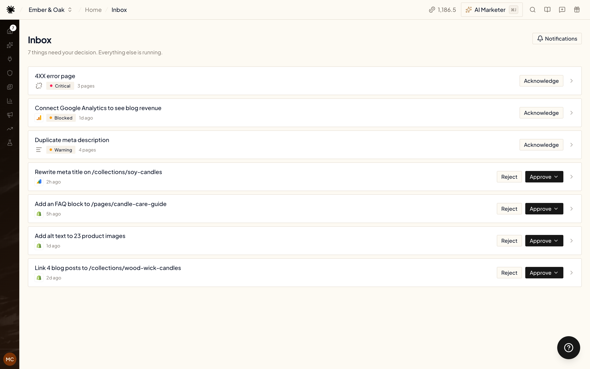

<video
  className="w-full aspect-video rounded-xl"
  controls
  preload="none"
  poster="https://gwvckixiegkllthleuyt.supabase.co/storage/v1/object/public/product-videos/posters/inbox.webp"
  src="https://gwvckixiegkllthleuyt.supabase.co/storage/v1/object/public/product-videos/inbox-v1.mp4"
  title="What lands in your Inbox?"
/>

Approvals flip the direction of work. Instead of you checking dashboards for problems, the agent continuously researches your connected accounts — SEO and paid — and when it finds something worth fixing, it files a proposal. You review the exact change, approve or reject, and on approval the agent applies it.

Proposals land on **Home**, in the **Needs you** list — the badge on Home shows how many are waiting. Click **View all** to open the **Inbox** with everything that needs your decision.

<Frame>
  
</Frame>

## What a proposal looks like

Every proposal is specific and grounded in your data — never "consider improving X". Open one to see:

- **Title and description** at the top — what's wrong, what it costs you, and why it matters, with real numbers from your accounts.
- **Entity** — the exact account and campaigns the change touches.
- **Proposed changes** — a before/after table of every change the agent wants to make.
- **Evidence** — the data the agent pulled to reach its conclusion.

Each proposal is labeled **SEO**, **Paid Ads**, **Local SEO** or **Conversions**, so you can tell at a glance which part of your marketing it touches.

## Approve or reject

- **Approve** — the agent applies the change to your account and verifies it landed. Use the arrow next to the button to pick **Approve with a note** when you want something done differently — for example "keep the daily budget at €20" or "apply only to the UK campaign". The agent reads your note before touching anything.
- **Reject** — nothing is touched. You can add an optional reason, which helps the agent propose better changes next time.

## After you decide

- An approved card moves to **Applying**, then to **Applied** or **Failed** — either way with an **Agent note** on what was done or why it didn't work. **Already resolved** means the agent re-checked and the problem was already gone.
- Your note from **Approve with a note** is shown on the card as **Your note**.
- **Expected impact** shows the estimated effect (**est.**) or, once there's data, the measured one (**measured**).
- **Tracing** → **View research run**, **View apply run** or **View revert run** opens the agent's chat for that card, so you can see exactly what it looked at and did.
- On a **Conversions** card, **Before and after** shows the conversion rate of the **Funnel step** the change fixed — before the change and after it, on **Phone**, **Desktop** or both. In the Inbox list, the row shows **Too little data** until enough visitors have passed through.

Every card carries one status: **Proposed**, **Applying**, **Applied**, **Failed**, **Already resolved**, **Rejected**, **Acknowledged** or **Reverted**.

## Undo an applied change

Changed your mind about a change the agent applied? Open the **Applied** card and click **Revert**, then confirm in **Revert this change**. The agent puts back the value from before the change. If someone has edited it since, it leaves everything as it is and tells you.

While it works, the card shows **Reverting**; when it's done, the status turns to **Reverted**. If the old value couldn't be confirmed, you'll see **Revert failed** and the change is treated as still live. **View revert run** under **Tracing** shows what the agent did. **Revert** is available on applied fixes — not on blocked items or opportunities — and only once per card.

## Decide from a chat

You can also approve, reject or revert a proposal by telling the [AI Marketer](/agent/chat) in chat — or Ryze in [Claude](/claude/connect), [ChatGPT](/chatgpt/connect) or [Grok](/grok/connect). Name the proposal and say what to do with it. The agent acts only on your own words about that specific proposal, never on its own judgement, and it works the same as clicking the button. The same goes for answering a question from a [managed campaign](/paid-ads/managed-campaigns).

## Blocked proposals

Sometimes the agent finds a real problem but can't fix it from its side — a tag that must be installed on your website, a pixel that needs verifying, a platform it has no access to. Those proposals arrive as **Blocked**: the same evidence and proposed changes, plus a blocker note that tells you exactly what to do and where.

- **I fixed it** — tell the agent you've resolved the blocker. It re-checks before proceeding — if the fix is actually live, the proposal moves forward; if not, it stays blocked and tells you what's still missing.
- **Acknowledge** — you've seen it and will handle it yourself.

## Opportunities

Besides fixes, the agent files a second kind of proposal: an **Opportunity** — demand you aren't capturing yet rather than something that's broken. Today these are SEO cards: a search query with real volume where you're outside the top 20, or a question AI assistants keep answering without naming you.

Each opportunity proposes **one new article for your Content Plan**. Instead of a before/after table, the card shows **Setup**:

- **Title**, **Primary keyword** and **Archetype** (the type of article)
- **Monthly searches**, when there's volume data
- **What it must cover** — the points the article has to answer
- **Replaces** and **Replaced topic searches** — when the article takes the place of a topic already planned

Under **Who can apply it**, the card says **Can be applied by Ryze**: click **Approve** and Ryze writes the article and publishes it like any other Content Plan article. Click **Reject** to skip it.

The agent keeps a short backlog, so you see at most a couple of opportunities at a time.

## Other items in your Inbox

The Inbox isn't only proposals. It also collects anything else that's waiting on you — for example articles that failed to publish, Technical Audit issues, or a managed campaign whose agent asked you a question.

## Get notified

Click **Notifications** at the top of the Inbox to choose who hears about new approvals — pick Slack channels, email recipients, or both, then **Save**. **Also add recipients to this workspace** gives each email address you add a seat in the workspace, with access to everything in it.

## Proposals from scheduled tasks

A [scheduled task](/agent/schedules) that finds a change worth making — a budget, bid, targeting, keyword, creative or content change — files it as a card here too. The agent can't read replies to the result email, so don't answer it with "approve" or new instructions: open **Home → Needs you** or the **Inbox** and click **Approve** or **Reject** on the card. To give the agent new instructions, start a new chat or edit the task.

## How proposals are found

The agent runs research on a regular cadence per product, in the background — no setup needed. It only files a proposal when it finds something concrete and worth your attention; quiet accounts produce no noise. Research runs are free — you only spend credits when you approve a fix and the agent applies it. The agent does pause research while your organization's credit balance is at zero, so if proposals stop arriving, check your balance first (see [Credits & Usage](/agent/credits)).

## Related

<CardGroup cols={2}>
  <Card title="Scheduled Tasks" icon="clock" href="/agent/schedules">
    Point the agent at your own recurring checks.
  </Card>
  <Card title="Credits & Usage" icon="coins" href="/agent/credits">
    How agent runs are billed.
  </Card>
</CardGroup>
