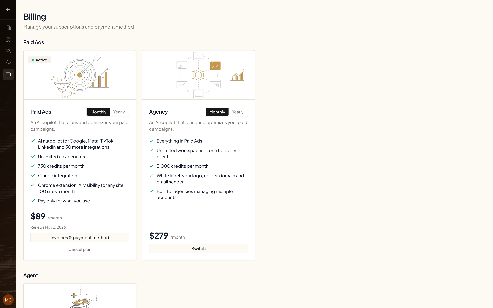

Everything about your subscription lives on the **Billing** page in your organization settings.

<video
  className="w-full aspect-video rounded-xl"
  controls
  preload="none"
  poster="https://gwvckixiegkllthleuyt.supabase.co/storage/v1/object/public/product-videos/posters/howto-plan-invoices-credits-v2.webp"
  src="https://gwvckixiegkllthleuyt.supabase.co/storage/v1/object/public/product-videos/howto-plan-invoices-credits-v2.mp4"
  title="Your plan, invoices and credits"
/>

## Open Billing

Go to **Organization Settings → Billing** ([open Billing](https://reports.get-ryze.ai/settings/billing)). Only the organization owner sees this page.

The page has three sections:

- **Paid Ads** — the Paid Ads and Agency plans.
- **Agent** — credit packs you can buy anytime.
- **SEO** — the SEO Starter and Traffic Printer plans.

<Frame>
  
</Frame>

Each plan card has a **Monthly / Yearly** switch. The plan you're on shows a status badge (**Trial**, **Active**, **Payment failed**…) and its date: **Trial ends**, **Renews** or **Cancels**, followed by the date.

## Switch your plan

- **Paid Ads ↔ Agency, monthly ↔ yearly:** on the plan you want (use the **Monthly / Yearly** switch to pick the period), click **Switch**, then **Switch now**. The switch is immediate: the prorated difference is charged to your card now and the plan renews at the new price. **If you're on a free trial, switching ends the trial and starts billing now.** You need a card saved under **Invoices & payment method** first.
- **SEO Starter → Traffic Printer:** click **Unlock Mentions** on the Traffic Printer card. See [Upgrade to Traffic Printer](#upgrade-seo-starter-to-traffic-printer).
- **SEO monthly → yearly:** on your plan's card, use the **Monthly / Yearly** switch to pick **Yearly**, click **Switch**, then **Switch now**. The switch is immediate: the first year is charged now with 30% off, minus the unused part of the current month, and extra websites move to yearly billing too. **If you're on a free trial, switching ends the trial and starts billing now.** You need a card saved under **Invoices & payment method** first.
- **Other SEO changes** (Traffic Printer → SEO Starter, yearly → monthly): email [support@get-ryze.ai](mailto:support@get-ryze.ai) and we'll change it for you.

## Upgrade SEO Starter to Traffic Printer

Click **Unlock Mentions** on the Traffic Printer card. It adds 50 high-quality backlinks with a domain rating of 30+, 3 editorial guest posts and 100+ PR placements every month. The difference is $470/month or $5,640/year for each website on your SEO plan. You're charged today for the rest of the current period; after that it renews together with your SEO subscription and covers all your websites.

If you're on the SEO Starter free trial, unlocking Mentions ends the trial and starts your subscription today. The amount is shown on the button before you pay.

## Other buttons on your plan

- **Start subscription now** — shown during a free trial. It ends the trial right away and charges the plan price today. Confirm with **Yes, start now**, or click **Keep my trial**.
- **Resume subscription** — shown after you cancel (the card says **Cancels** and the date; on a trial, **Trial ends** and the date) and on a paused plan. Click it to keep the plan; nothing else changes.
- **Paused** — a paused plan shows *Subscription paused — resume anytime, your setup stays saved.* You aren't charged while the plan is paused. Click **Resume subscription** to restart billing. If you see *Add a payment method first, then resume the subscription.*, click **Update payment method**, add a card, then click **Resume subscription** again.
- **Payment failed** — the card shows *Payment failed — update your card to keep access.* Click **Update payment method** to fix it.
- **Complete payment** — finishes a checkout that still needs your confirmation (status **Pending**).

Status badges you may see: **Trial**, **Active**, **Payment failed**, **Canceled**, **Pending**, **Expired**, **Unpaid**, **Paused**.

## Cancel your subscription

1. Click **Cancel plan** under the plan.
2. Ryze shows what's running on your account and asks a few questions. To keep cancelling, click **Continue cancellation**, **Cancel anyway** or **I still want to cancel** on each screen.
3. Pick a reason (and add details if you like).
4. On **Are you sure?**, click **Confirm cancellation**.

Your subscription stays active until the end of the paid period — the card then shows **Cancels** and the date your plan ends. You won't be charged again after that. If you cancel during a trial, auto-renew turns off and the trial simply ends on the date shown under **Trial ends**.

Changed your mind? Click **Resume subscription** on the plan before that date.

### Cancelling SEO for one website only

**Cancel plan** on an SEO subscription ends SEO for every website on it — with several websites, the last screen says so. To stop SEO for one website only, or to move your SEO plan to a different website, email [support@get-ryze.ai](mailto:support@get-ryze.ai) from your account address and we'll adjust the subscription for you.

## Invoices and payment card

Click **Invoices & payment method** to download invoices, update your card, or add company and VAT details. See [Invoices & Payment Method](/billing/invoices-and-payment).

## Delete your account

Cancelling keeps your account. To remove the organization and everything in it, see [Delete your account](/workspaces/delete-account).
