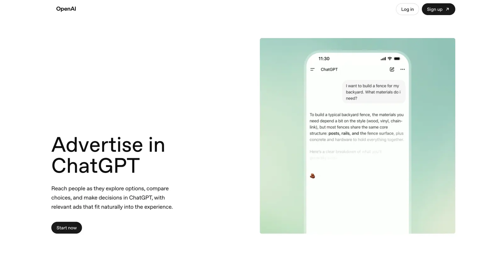
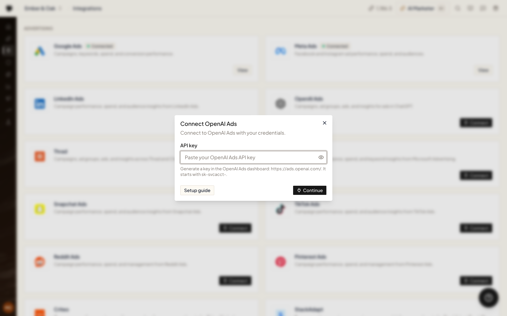

OpenAI Ads connects with an **API key** you generate in the OpenAI Ads dashboard.

## Step 1 — Get your API key

<Steps>
  <Step title="Open OpenAI Ads">
    Go to [ads.openai.com](https://ads.openai.com/) and sign in (or sign up) to the Ads Manager.
    <Frame></Frame>
  </Step>
  <Step title="Open Settings">
    In the Ads Manager, open **Settings** from the left menu.
  </Step>
  <Step title="Create a new API key">
    Under **Settings → General → Account Info**, click **Create New Key**. Give it a name like `Ryze`, then click **Create**. Copy the key — you'll need it next.
  </Step>
</Steps>

## Step 2 — Connect in Ryze

On the **Integrations** page, click **Connect** on the **OpenAI Ads** card, paste your API key (it starts with `sk-svcacct-`) into **API key**, and click **Continue**.

To add another OpenAI Ads account, click **View** → **Add one more account**.

<Frame>
  
</Frame>

## What you can do with it

- **[Managed Campaigns](/paid-ads/managed-campaigns)** — pick OpenAI Ads as one of the platforms, and the agent builds and runs the campaign there.
- **[Ads Performance](/analytics/performance)** — OpenAI Ads spend, clicks and results show up next to your other ad accounts.
- **Chat** — ask about campaigns, spend, conversions and attributed sales, or ask the agent to make changes.

## What the agent can do

- **Read** — the ad account, campaigns, ad groups, ads, conversion events and statistics, including conversions and attributed sales.
- **Change** — create and update campaigns, ad groups and ads, pause and activate them, and upload images for ad creatives.
- **Archive** — OpenAI Ads has no delete: removing a campaign, ad group or ad archives it, and an archived object can't be restored.

By default the agent runs its tools on its own: the [**Tool approvals**](/agent/chat#tool-approvals) setting in the chat composer starts on **Skip all approvals**. To review changes before they happen, switch it to **Approve write & delete** (reads run freely, changes need approval) or **Manual approve** (every tool that touches your data needs approval). Scheduled tasks run without an approval step. In Claude, approvals are set in Claude itself — set write and delete tools to **Needs approval** to be asked first (see [Permissions & approvals](/claude/permissions)).

## Troubleshooting

- **"That is not an OpenAI Ads API key. The key starts with sk-svcacct-…"** — the value doesn't look like an API key at all. Copy the whole key from [ads.openai.com](https://ads.openai.com/).
- **"OpenAI Ads rejected this API key. Generate a new key in the OpenAI Ads dashboard and paste the whole value."** — OpenAI Ads doesn't accept this key. Usually it's a regular OpenAI platform key (`sk-proj-…`). Create the key in the OpenAI Ads dashboard (**Settings → General → Account Info**) and paste the whole value.

Need help? Email [support@get-ryze.ai](mailto:support@get-ryze.ai).
