The default [Shopify connection](/integrations/shopify) needs only your store domain and one approval click — Ryze requests a standard set of permissions for you. A **custom app** is the alternative, and you need one when:

- You want the agent to edit theme files (for example `robots.txt`, structured data or canonical tags in the theme) or create 301 redirects. The standard Shopify app can't do either — only a custom app with the right scopes can.
- You define exactly which Admin API scopes Ryze gets — nothing more.
- You can rotate the credentials or revoke access any time from your Shopify admin.
- Access runs through an app your team owns, not a third-party install.

If our defaults work for you, the default connection is faster. Otherwise, let the agent set up the app for you, or follow the steps below: create the app, configure it, copy the credentials, connect.

## Fastest way: let AI Marketer set it up

Open AI Marketer in the full chat view (from the sidebar, click **Open as full chat** first) and ask, for example:

```
Set up a Shopify custom app for theme edits and redirects
```

A browser panel opens next to the chat. You do two things:

1. **Log in to Shopify** in that panel — with a password, Google or an email code. Passkeys don't work in this browser.
2. **Paste the credentials yourself.** The agent creates and configures the app and opens its **Settings** page with the **Client ID** and **Client secret**. In the Shopify connect form, switch to the **Custom app** tab and paste both values. Ryze never types your secret for you.

If a Shopify connection already exists in the workspace, remove it first — **Reconnect** keeps the old access.

The agent setup works in the Ryze app only, not from Slack. The manual steps below do the same thing by hand.

## Step 1 — Create a custom app in Shopify

<Warning>
  Create the app from the Shopify organization that owns this store. An app created in another organization's Dev Dashboard (for example, your agency's or partner account) can't connect to the store.
</Warning>

<Steps>
  <Step title="Open Settings → Apps">
    In your Shopify admin, go to **Settings**, then open **Apps and sales channels**.
    <Frame>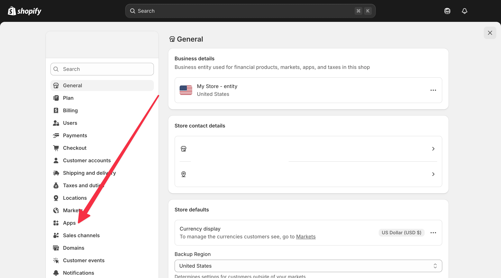</Frame>
  </Step>
  <Step title="Click Develop apps">
    In the top-right corner, click **Develop apps**.
    <Frame>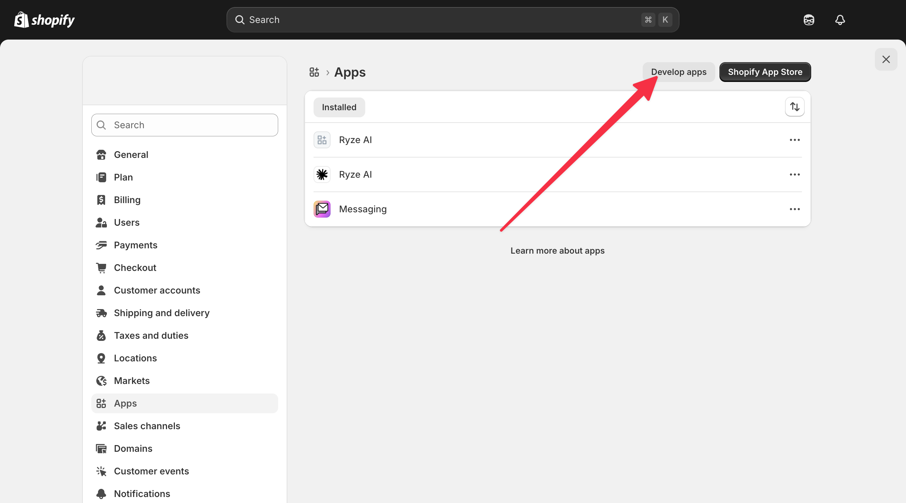</Frame>
  </Step>
  <Step title="Open the Dev Dashboard">
    Click **Build apps in Dev Dashboard**.
    <Frame>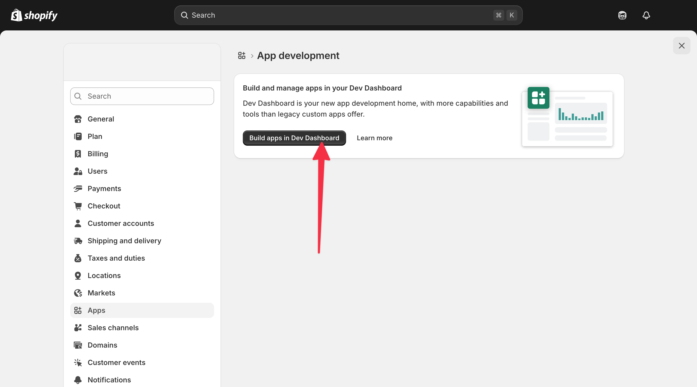</Frame>
  </Step>
  <Step title="Create an app">
    Click **Create app**.
    <Frame>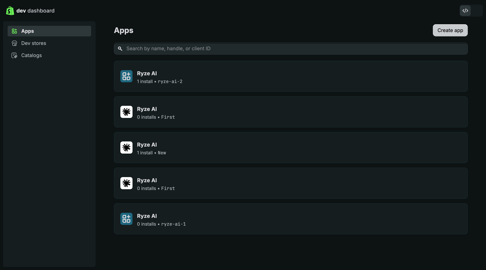</Frame>
  </Step>
  <Step title="Name the app">
    Under **Start from Dev Dashboard**, enter a name (e.g. `Ryze AI`) and click **Create**.
    <Frame>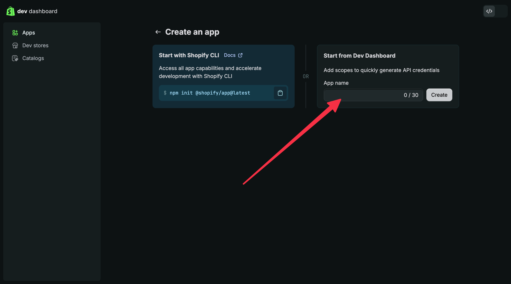</Frame>
  </Step>
</Steps>

## Step 2 — Configure the app

<Steps>
  <Step title="Set the App URL">
    Under **URLs → App URL**, enter `https://reports.get-ryze.ai` and **uncheck Embed app in Shopify admin**. Ryze runs as a standalone app and will not load inside the Shopify admin frame; with the box checked, opening the app from Shopify shows a blank page.
    <Frame>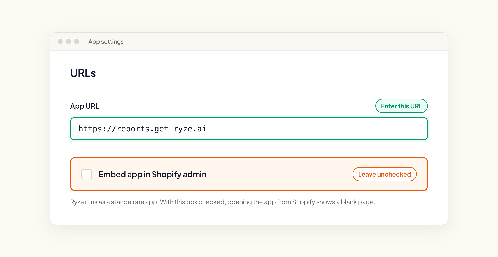</Frame>
  </Step>
  <Step title="Add the scopes you want Ryze to have">
    Under **Access → Scopes**, paste this comma-separated list — or trim it to just the features you plan to use. Missing scopes won't block the connection, but the related features will fail later (for example, without `write_content` Ryze can't publish articles to your blog). You can always add scopes later in the same screen — but scopes added later only take effect after you **Release** a new version and **Install/approve** it on your store (Steps below), then reconnect once in Ryze.

    ```
    read_analytics,read_content,read_metaobjects,read_orders,read_products,read_publications,read_reports,read_themes,write_content,write_metaobjects,write_products,write_publications,write_themes
    ```

    <Note>
      A custom app can also grant scopes our default connection never requests. Add these only if you need them: `read_markets,write_markets` for market and domain settings, and `write_online_store_navigation` for URL redirects. Proposals that depend on these stay **Blocked** on the default connection, because those scopes are not part of the standard Ryze app.
    </Note>
    <Frame>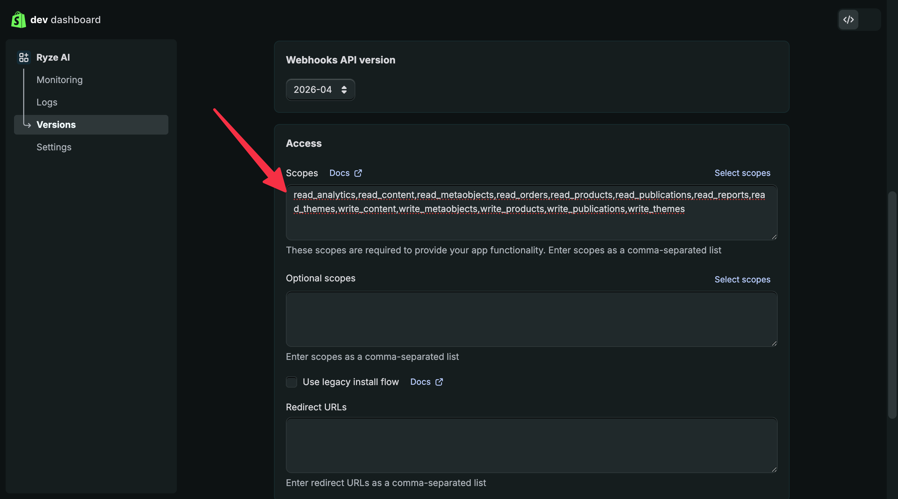</Frame>
  </Step>
  <Step title="Add the redirect URL">
    Under **Redirect URLs**, enter `https://reports.get-ryze.ai/api/auth/shopify/callback`.
    <Frame>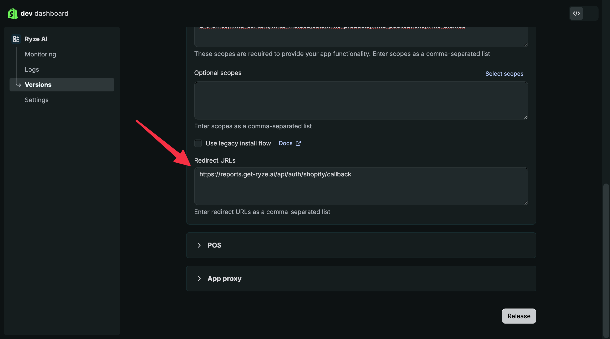</Frame>
  </Step>
  <Step title="Release the version">
    Click **Release**, confirm in the dialog, and release the version. This activates the app.
    <Frame>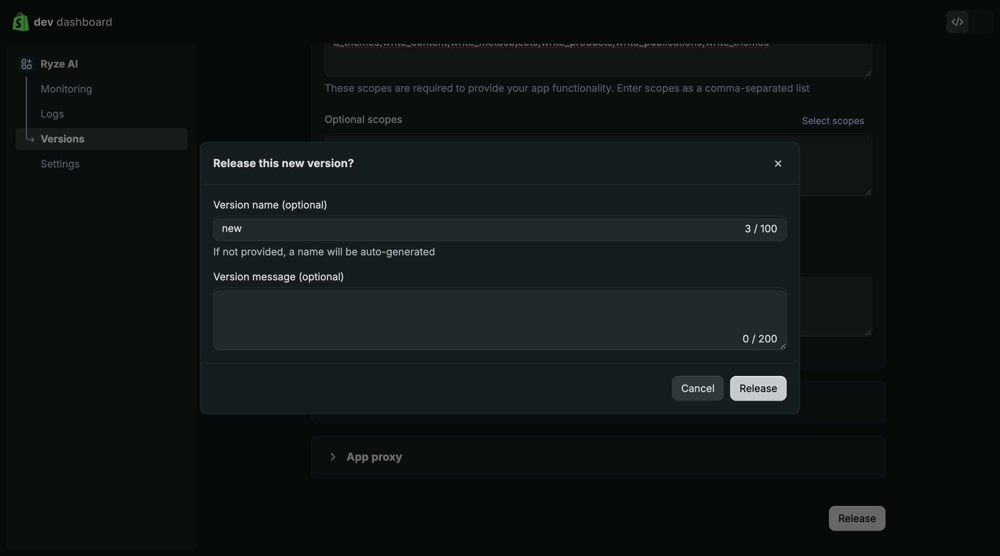</Frame>
  </Step>
  <Step title="Install the app on your store">
    Open the app and click **Install app** (top-right). This installs the app on your store so Ryze can fetch an access token.
    <Frame>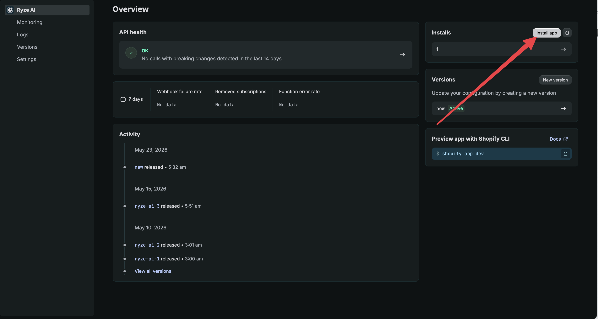</Frame>

    <Warning>
      Don't skip this step. Without installing the app, the connection fails with **"The custom app exists, but it isn't installed on this store yet…"** — even though your Client ID and Secret are correct. The same message can appear later if the app is uninstalled from the store: install it again, then click **Reconnect** in Ryze.
    </Warning>
  </Step>
</Steps>

## Step 3 — Copy your credentials

<Steps>
  <Step title="Open Settings → Credentials">
    In the app, open **Settings**. Copy the **Client ID**, then reveal and copy the **Secret** (this is your Client secret).
    <Frame>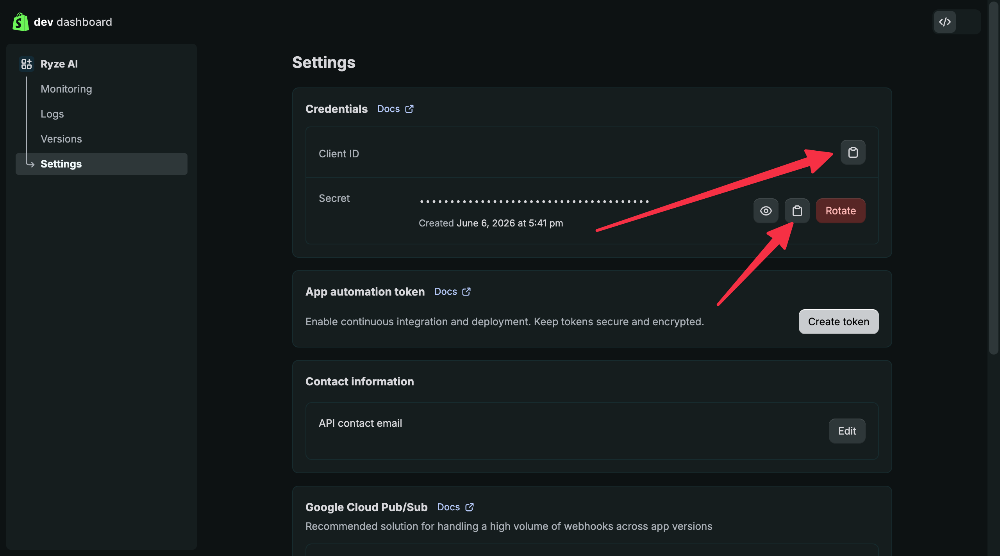</Frame>
  </Step>
  <Step title="Find your store domain">
    Back in your Shopify admin, open **Settings → Domains**. Your store domain is the `.myshopify.com` address listed there (it is there even when your own domain is primary).
    <Frame>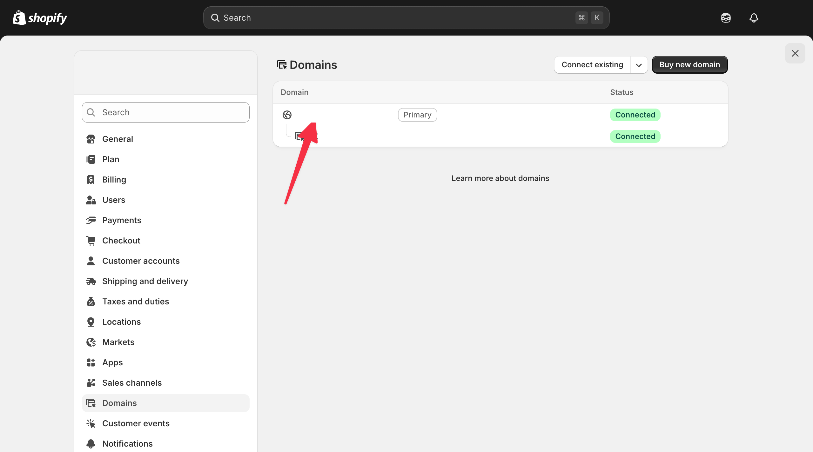</Frame>
  </Step>
</Steps>

## Step 4 — Connect in Ryze

On the **Integrations** page, click **Connect** on the Shopify card and switch to the **Custom app** tab, then fill in:

- **Store domain** — e.g. `yourstore.myshopify.com`
- **Client ID** — the Client ID you copied
- **Client secret** — the Secret you copied

Click **Continue**. Ryze verifies the credentials against your store immediately — if something's wrong, you'll know right away. Tokens refresh automatically using your app's credentials, no maintenance needed.

To revoke access later, uninstall the app in your Shopify admin. To rotate the secret, generate a new one under **Credentials** and reconnect in Ryze.

## Errors when connecting

- **"The custom app exists, but it isn't installed on this store yet…"** — open the app in the Dev Dashboard, click **Install app** (top-right), then connect again.
- **"Shopify has no app with this Client ID on this store…"** — check that the store domain is this store's `.myshopify.com` address and that you copied the **Client ID** from this app's **Settings → Credentials**. Or connect on the **Shopify app** tab instead, without keys.
- **"Shopify refuses custom-app credentials for this store: the app and the store must belong to the same organization in the Dev Dashboard…"** — the app was created in another organization. Create it again from the organization that owns the store, then connect again. Or use the **Shopify app** tab.
- **"Shopify has no store at …"** — the domain is wrong. Copy the `.myshopify.com` address from **Settings → Domains** in your Shopify admin and try again.

More fixes: [Shopify not connecting](/troubleshooting/shopify-not-connecting).

Need help? Email [support@get-ryze.ai](mailto:support@get-ryze.ai).
