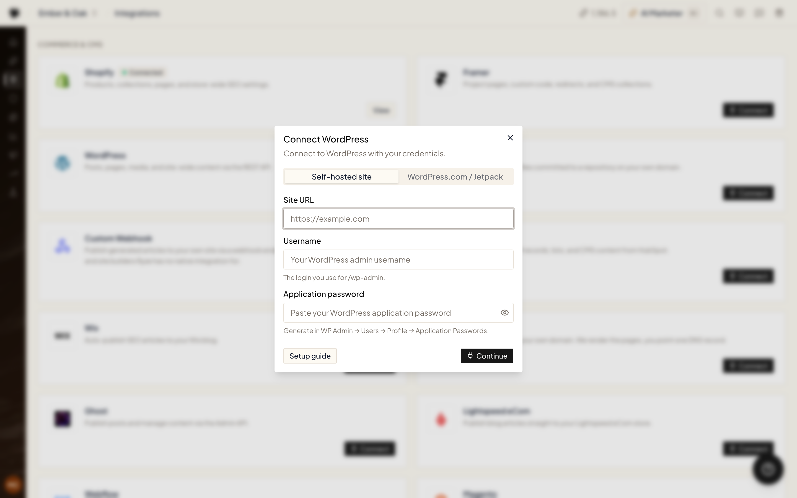
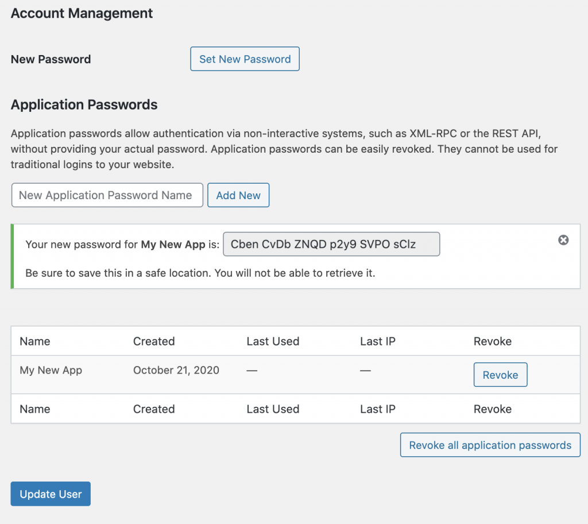

<video
  className="w-full aspect-video rounded-xl"
  controls
  preload="none"
  poster="https://gwvckixiegkllthleuyt.supabase.co/storage/v1/object/public/product-videos/posters/howto-connect-wordpress.webp"
  src="https://gwvckixiegkllthleuyt.supabase.co/storage/v1/object/public/product-videos/howto-connect-wordpress-v1.mp4"
  title="How to connect WordPress"
/>

There are two ways to connect WordPress, depending on where your site lives:

- **Self-hosted site** — your WordPress runs on your own hosting (you log in at `yoursite.com/wp-admin`). Connects with an **application password**.
- **WordPress.com / Jetpack** — your site is hosted on WordPress.com, or it's self-hosted but connected through the Jetpack plugin. Connects with one click — you're redirected to WordPress.com to authorize access, no passwords to copy.

<Frame>
  
</Frame>

Not sure which one you have? If you log in at `wordpress.com`, pick **WordPress.com / Jetpack**. If you log in at your own domain's `/wp-admin`, pick **Self-hosted site**.

## Option A — WordPress.com / Jetpack

<Steps>
  <Step title="Open Integrations">
    On the **Integrations** page, click **Connect** on the WordPress card and select the **WordPress.com / Jetpack** tab.
  </Step>
  <Step title="Authorize on WordPress.com">
    You're redirected to WordPress.com. Sign in and approve access.
  </Step>
  <Step title="Pick your site">
    If your account has several sites, choose the one Ryze should publish to. Done — no passwords needed.
  </Step>
</Steps>

<Note>
For Jetpack sites, make sure the Jetpack **JSON API** module is enabled — Ryze publishes through it. If the connection fails, enable the module in Jetpack settings and reconnect.
</Note>

## Option B — Self-hosted site

A self-hosted site connects with an **application password** — a special key you generate in WordPress that lets Ryze access your site without sharing your real login.

Create it for a user with the **Editor** or **Administrator** role. **Editor** is enough to publish articles; choose **Administrator** if the agent should also update Yoast SEO or Rank Math fields or add code to your site's `<head>` (see [SEO plugins and Code Snippets](#seo-plugins-and-code-snippets)).

### Step 1 — Generate an application password

<Steps>
  <Step title="Open your profile">
    In your WordPress admin, go to **Users → Profile** (or **Users → All Users → your user → Edit**).
  </Step>
  <Step title="Find Application Passwords">
    Scroll to the bottom of the profile page to the **Application Passwords** section.
  </Step>
  <Step title="Create the password">
    Enter a name like `Ryze`, then click **Add New Application Password**. WordPress shows the generated password **once** — copy it now.
    <Frame></Frame>
  </Step>
</Steps>

<Warning>
The application password is shown only once. If you lose it, just generate a new one.
</Warning>

### Step 2 — Connect in Ryze

On the **Integrations** page, click **Connect** on the WordPress card, select the **Self-hosted site** tab, and fill in:

- **Site URL** — your site address, e.g. `https://example.com`
- **Username** — the login you use to sign in to WordPress admin (usually at `/wp-admin`)
- **Application password** — the password you just copied

Click **Continue**. Ryze verifies the connection.

## After connecting

Click **View** on the WordPress card to optionally choose the **Author** and **Category** new posts use, then click **Save**.

To publish to several WordPress sites, click **View** → **Add one more account** and connect the next site.

## How publishing works

- Each article is published as a post with its title, text, excerpt and featured image, using the **Author** and **Category** you chose in **View**.
- The SEO title and meta description are also sent to the **Yoast SEO** or **Rank Math** fields of the post. WordPress saves them once those fields are open to the REST API — see below.
- **Republish** updates the same post at the same address. **Unpublish** deletes the post from WordPress for good (it doesn't go to Trash).
- On sites connected through **WordPress.com / Jetpack**, posts are published without Ryze's style block and FAQ structured data, because WordPress.com would show them as plain text.

## SEO plugins and Code Snippets

On a self-hosted site, WordPress doesn't let outside apps write Yoast SEO or Rank Math fields by default. When you ask the agent to update SEO titles or meta descriptions, it adds a small snippet (**Ryze Yoast REST Bridge** or **Ryze Rank Math REST Bridge**) through the free **Code Snippets** plugin, which opens those fields to the REST API. Code you ask the agent to add to every page's `<head>` (tracking tags, pixels, verification tags) goes in through Code Snippets the same way.

- If **Code Snippets** is already active, the agent uses it. If it isn't installed, the agent asks you first before installing it.
- Installing plugins and snippets needs the **Administrator** role. With a lower role, reconnect with an administrator's application password.
- This doesn't work on **WordPress.com** connections — there's no plugin access. Paste head code into your theme's header or a header-scripts plugin yourself.

On pages built with **Elementor**, the agent makes content fixes in the Elementor page data (WordPress keeps a separate copy that Elementor doesn't show) and checks the change on the live page.

## Troubleshooting

- **"WordPress rejected the credentials. Check the username and application password."** (self-hosted) — double-check the username and application password.
- **"WordPress never received the login…"** — one of four things: the site isn't on `https://` (application passwords need it), application passwords are turned off on the site, none has been created yet, or the host strips the Authorization header. Fix the one that applies, then connect again.
- **"WordPress has no user with this username…"** — enter the WordPress login name of the user who created the application password.
- **"The application password does not match this user…"** — copy it again from **Users → Profile → Application Passwords** (spaces are fine), or generate a new one.
- **"Application passwords are turned off for this WordPress user…"** — a security plugin or a filter disables them for this account or role. Enable them for the user, then connect again.
- **REST API not found** — make sure the WordPress REST API is enabled and the site URL is correct.
- **Jetpack site won't connect** — enable the Jetpack JSON API module, then reconnect.
- **Can't reach the site** — verify the site URL is reachable and uses `https://`.
- **"…redirects WordPress requests to … Connect the site with the address it redirects to."** — your site moves `/wp-json` requests to another address (for example from or to `www`). Connect with the exact final address.
- **"…redirects WordPress requests to plain http…"** — the site sends `/wp-json` to `http://`, where the application password would travel unencrypted. Make the site answer `/wp-json` over HTTPS, then try again.
- **"…rewrites our requests to … (a host rule). Allowlist Ryze on the host, then try again."** or **"…keeps redirecting our requests…"** — a host or security rule redirects `/wp-json` calls. Allowlist Ryze or ask the host to stop redirecting `/wp-json`, then try again.
- **"…did not answer within … seconds. A firewall, security plugin or host may be holding our requests…"** — allowlist Ryze in your firewall or security plugin, then try again.
- **"…is rate-limiting requests right now (HTTP 429)…"** — wait a minute and try again, or allowlist Ryze in the site's rate limiter.
- **"…a security plugin, WAF or host is blocking Ryze. Allowlist our requests, then reconnect."** or **"…the site is likely behind a bot challenge, maintenance mode, or a security plugin intercepting /wp-json requests"** — Cloudflare, Wordfence or your host's firewall is blocking requests to `/wp-json`. Allowlist requests from Ryze (the user agent contains `Ryze/1.0` and `get-ryze.ai`) or turn off the bot-protection rule for `/wp-json`, then reconnect.
- **My login page isn't `/wp-admin`** — that's fine. Enter the username you sign in with and its application password; the login address itself doesn't matter.
- **"Featured image skipped — the image could not be uploaded to the WordPress media library."** — the article is published without a cover. Republish later, or add the image in WordPress.
- **"The cover image was uploaded to the media library but WordPress did not attach it to the post as the featured image; set it in the post editor."** — Ryze already retried once. Open the post in WordPress and set the featured image by hand.

Still stuck? Email [support@get-ryze.ai](mailto:support@get-ryze.ai).
